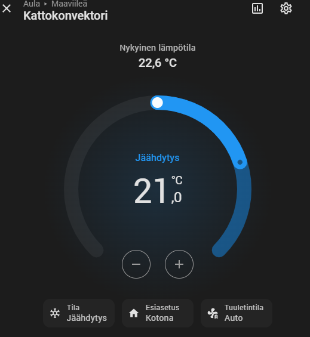
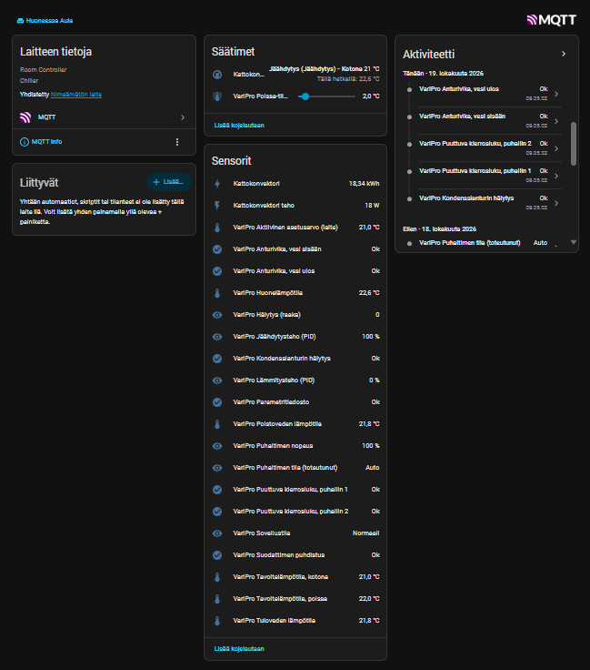

# VariPro Modbus-MQTT Bridge

Python-silta, joka liittää **Chiller VariPro** -huonesäätimen (ja sen ohjaamat
GRAND / BOX / STUDIO VariPro -puhallinkonvektorit) Home Assistantiin yhtenä
MQTT-discovery-climate-entiteettinä.

VariPron natiivi Home Assistant -integrointi `modbus`-komponentin `climate`-alustalla
on mahdollinen, mutta se ei tue laitteen **poissa-tilaa** (oma tavoitelämpötila +
laajennettu kuollut alue) eikä tuota kunnollista toiminta- ja hälytystietoa. Tämä
silta hoitaa koko laitteen yhtenä siistinä entiteettinä ja lisää joukon
diagnostiikkasensoreita.

<p align="center">
  
</p>

> Kehitetty iteratiivisesti Claude-tekoälyn avustuksella, oikealla laitteella testaten.

## Ominaisuudet

- **Yksi climate-entiteetti** koko laitteelle: hvac mode, puhallin, tavoitelämpö, toiminta
- **Preset home / away** — erilliset tavoitelämpötilarekisterit säilyvät toisistaan riippumatta
- **hvac_action PID-lähdöistä** — kortti näyttää rehellisesti jäähdyttääkö (`cooling`) tai lämmittääkö (`heating`) laite, pyöriikö puhallin ilman jäähdytystä (`fan`) vai onko se joutilaana (`idle`)
- **Fan only -tila** — synteettinen tuuletustila (away + kuollut alue 15 °C) joka ei riko oikeaa away-tavoitetta; tilannekuva tallennetaan levylle, joten pysäytys, uudelleenkäynnistys ja kaatuminen palautuvat siististi
- **Hälytykset binary-sensoreina** — kondenssi, puhallinvika, anturiviat, suodatinmuistutus (purettu hälytysbittikentästä)
- **Diagnostiikkasensorit** — jäähdytys-/lämmitys-PID, vesien tulo/lähtö, aktiivinen asetusarvo, puhaltimen toteutunut tila, huonelämpötila
- **Poissa-tilan kuollut alue** säädettävänä number-entiteettinä
- **Luotettava availability** — entiteetit muuttuvat HA:ssa "ei käytettävissä" -tilaan, jos silta kaatuu (MQTT last will) tai Modbus-yhdyskäytävä lakkaa vastaamasta
- **Säästeliäs väyläkäyttö** — peräkkäiset rekisterit luetaan ryhmissä, porrastetut pollausvälit, kaikki liikenne yhdessä säikeessä ja ≥ 200 ms kyselyjen välissä; kirjoitussuoja estää UI:n välkkymisen

Laite näkyy Home Assistantissa yhtenä laitteena, jonka alla on climate-entiteetti
sekä diagnostiikka- ja hälytyssensorit:

<p align="center">
  
</p>

## Vaatimukset

- Python 3.10+
- `pymodbus` 3.10+ ja `paho-mqtt` 2.x (asentuvat automaattisesti, ks. alla)
- MQTT-broker (esim. Mosquitto) jonka Home Assistant näkee
- Home Assistantin MQTT-integraatio käytössä (discovery päällä)
- VariPro-säädin RS-485 → Modbus TCP -yhdyskäytävän takana (TCP/502)

## Asennus

Silta asennetaan omaan virtuaaliympäristöönsä, joten se ei riipu jakelun
Python-pakettien versioista.

```bash
sudo apt install git python3-venv
sudo git clone https://github.com/quenthal/varipro-modbus-mqtt.git /opt/varipro-modbus-mqtt
cd /opt/varipro-modbus-mqtt
sudo python3 -m venv .venv
sudo .venv/bin/pip install .
```

Kokeilu käsin (Ctrl+C lopettaa siististi):

```bash
VARIPRO_MODBUS_HOST=<yhdyskäytävä> VARIPRO_MQTT_HOST=<broker> \
  /opt/varipro-modbus-mqtt/.venv/bin/varipro-bridge
```

### Systemd-palveluna

```bash
sudo cp varipro.env.example /etc/varipro.env   # muokkaa arvot
sudo chmod 600 /etc/varipro.env                 # sisältää MQTT-salasanan
sudo cp varipro.service /etc/systemd/system/
sudo systemctl daemon-reload
sudo systemctl enable --now varipro
journalctl -u varipro -f
```

Palvelu ajetaan omalla dynaamisella käyttäjällä (ei root) ja fan only
-tilannekuva tallentuu hakemistoon `/var/lib/varipro/`. Jos palvelu ei
käynnisty LXC-kontissa (virhe `226/NAMESPACE`), ks. ohjeet `varipro.service`-tiedostossa.

### Päivitys

```bash
cd /opt/varipro-modbus-mqtt
sudo git pull
sudo .venv/bin/pip install .
sudo systemctl restart varipro
```

### Päivitys versiosta 1.x

Versio 1 asennettiin tiedostona `/opt/varipro_bridge.py` ja ajettiin järjestelmän
Pythonilla roottina.

1. **Laita fan only pois päältä** Home Assistantista ennen pysäytystä (v1 ei
   palauta tilaa `systemctl stop` -komennolla). Tarkista ettei tiedostoa
   `/opt/varipro_fanonly.json` ole jäänyt.
2. `sudo systemctl stop varipro`
3. Asenna yllä olevan ohjeen mukaan ja kopioi uusi `varipro.service`. Vanha
   `/etc/varipro.env` kelpaa sellaisenaan. Jos asetukset oli kirjoitettu suoraan
   `varipro_bridge.py`:hyn, siirrä ne tiedostoon `/etc/varipro.env`
   (`VARIPRO_MODBUS_HOST` on nyt pakollinen, MQTT:n oletus on `localhost`).
4. `sudo systemctl daemon-reload && sudo systemctl restart varipro`
5. Kun uusi toimii: `sudo rm /opt/varipro_bridge.py`

Entiteettien `unique_id`:t ja topicit ovat ennallaan, joten Home Assistantin
entiteetit, automaatiot ja historia säilyvät. Sensorien nimistä poistui
"VariPro"-etuliite (HA lisää laitteen nimen itse), ja diagnostiikkasensorit
siirtyvät laitesivulla Diagnostiikka-osioon.

## Konfiguraatio

Kaikki asetukset ympäristömuuttujina (oletus suluissa):

| Muuttuja | Kuvaus |
|---|---|
| `VARIPRO_MODBUS_HOST` | Modbus TCP -yhdyskäytävän osoite (**pakollinen**) |
| `VARIPRO_MODBUS_PORT` | Modbus-portti (`502`) |
| `VARIPRO_MODBUS_TIMEOUT` | Vastauksen aikakatkaisu sekunteina (`5`) |
| `VARIPRO_SLAVE` | Modbus slave -osoite (`1`) |
| `VARIPRO_MQTT_HOST` | MQTT-brokerin osoite (`localhost`) |
| `VARIPRO_MQTT_PORT` | MQTT-portti (`1883`) |
| `VARIPRO_MQTT_USER` | MQTT-käyttäjä (tyhjä = ei autentikointia) |
| `VARIPRO_MQTT_PASS` | MQTT-salasana |
| `VARIPRO_TOPIC_PREFIX` | Topicien ja tunnisteiden etuliite (`varipro`); toiselle säätimelle eri arvo |
| `VARIPRO_DISCOVERY_PREFIX` | HA:n discovery-etuliite (`homeassistant`) |
| `VARIPRO_MIN_TEMP` / `VARIPRO_MAX_TEMP` | Sallittu tavoitelämpö (`18` / `24`) |
| `VARIPRO_DEADZONE_MAX` | Kuolleen alueen yläraja (`15`) |
| `VARIPRO_STATE_DIR` | Tilannekuvan hakemisto (systemd: `/var/lib/varipro`, muuten skriptin hakemisto) |
| `VARIPRO_LOG_LEVEL` | `DEBUG` / `INFO` / `WARNING` (`INFO`) |

Silta tarkistaa MQTT-komennot: rajojen ulkopuoliset tai tuntemattomat arvot
ohitetaan ja HA:lle lähetetään takaisin todellinen tila.

## Modbus-rekisterikartta (käytetyt)

VariPro-käyttöliittymän rekisterikartta v1.4 (N03104128). Huomaa: osoitteet
ovat 0-pohjaisia (pymodbus), eli esim. "4x00001" = osoite 0.

| Osoite | Tyyppi | L/K | Sisältö | Skaalaus |
|---|---|---|---|---|
| 0 | holding | K | Sovellustila (1=off, 2=normaali, 3=poissa, 4=huuhtelu, 5=pysähtynyt, 10=testi) | — |
| 2 | holding | K | Puhallin (0=off, 1=low, 2=medium, 3=high, 4=auto) | — |
| 3 | holding | K | Tavoitelämpö, kotona | ×0.1 °C |
| 4 | holding | K | Tavoitelämpö, poissa | ×0.1 °C |
| 201 | holding | K | Poissa-tilan kuollut alue (0–15 °C) | ×0.1 °C |
| 3 | input | L | Sovellustila (nykyinen) | — |
| 5 | input | L | Puhaltimen säätö (toteutunut) | — |
| 6 | input | L | Huonelämpötila | ×0.1 °C |
| 7 | input | L | Aktiivinen asetusarvo | ×0.1 °C |
| 8 | input | L | Puhaltimen nopeus | % |
| 9 | input | L | Jäähdytyksen PID-lähtö | % |
| 10 | input | L | Lämmityksen PID-lähtö | % |
| 102 | input | L | Hälytys (bittikenttä, ks. alla) | — |
| 115–116 | input | L | Tulo-/poistoveden lämpötila | ×0.1 °C |

**Hälytysbitit (rekisteri 102):** 0=kondenssi, 1=puhallin 1 rpm, 2=puhallin 2 rpm,
3=anturivika vesi sisään, 4=anturivika vesi ulos, 11=parametritiedosto,
15=suodatinmuistutus.

**Väylän vaatimukset (manuaali) ja miten silta ne hoitaa:**

| Manuaali | Silta |
|---|---|
| Kyselyjen väli ≥ 200 ms | Väh. 200 ms jokaisen kyselyn ja kirjoituksen välissä |
| Vastauksen aikakatkaisu 2000 ms | Odottaa vastausta 5 s (`VARIPRO_MODBUS_TIMEOUT`) |
| Jaksolliset kirjoitukset ≥ 5 min välein | Ainoa jaksollinen kirjoitus on fan onlyn uudelleenkirjoitus 5 min välein; käyttäjän komennot kirjoitetaan heti |

## MQTT-topicit

| Topic | Suunta | Sisältö |
|---|---|---|
| `varipro/temp/current` | pub | Huonelämpötila |
| `varipro/temp/target` | pub | Aktiivisen presetin tavoite (`None` fan onlyssa) |
| `varipro/temp/target_home` / `_away` | pub | Presettien tavoitteet erikseen |
| `varipro/temp/set` | sub | Aseta tavoite |
| `varipro/mode` ⇄ `/set` | pub/sub | off / cool / fan_only |
| `varipro/fan` ⇄ `/set` | pub/sub | auto / low / medium / high |
| `varipro/preset` ⇄ `/set` | pub/sub | home / away |
| `varipro/action` | pub | idle / cooling / heating / fan / off |
| `varipro/deadzone` ⇄ `/set` | pub/sub | Poissa-tilan kuollut alue |
| `varipro/alarm/<nimi>` | pub | Hälytysbitit (ON/OFF) |
| `varipro/bridge/status` | pub | online / offline (sillan availability, last will) |
| `varipro/modbus/status` | pub | online / offline (offline 3 peräkkäisen lukuvirheen jälkeen) |
| `homeassistant/status` | sub | HA:n käynnistyessä discovery ja tilat julkaistaan uudelleen |

## Suunnitteluvalintoja

- **mode vs. preset:** laitteen rekisteri 0 kantaa sekä päälle/pois- että
  home/away-tiedon. Silta erottaa nämä HA:n käsitteiksi: `hvac_mode` (off/cool)
  kertoo mitä laite tekee, `preset` (home/away) millä profiililla.
- **Fan only** ei ole laitteen natiivi tila. Se toteutetaan asettamalla poissa-tila
  + kuollut alue 15 °C (jäähdytys ei käynnisty) ja manuaalinen puhallinnopeus.
  Oikea away-tavoite ei muutu, ja tila palautetaan levylle tallennetusta
  tilannekuvasta (tila, kuollut alue ja puhallin) sillan pysähtyessä tai, jos
  silta kaatui, seuraavassa käynnistyksessä. Jos tila on sillä välin vaihdettu
  paneelista, paneelin valinta jää voimaan. Epäonnistunut palautus yritetään
  uudelleen, kun väylä vastaa.
- **Away-preset ei säily laitteen off-syklin yli** (tietoinen valinta): off→cool
  palaa home-tilaan. Jos tarve, hoida se HA-automaatiolla, ei sillan logiikalla.
- **Kirjoitussuoja:** laite voi hetken kirjoituksen jälkeen palauttaa vielä vanhan
  arvon. Silta ohittaa kirjoitetusta poikkeavat lukemat 15 s ajan, joten kortti
  ei hypi takaisin vanhaan arvoon.

## Kehitys

```bash
python3 -m venv .venv
.venv/bin/pip install -e '.[dev]'
.venv/bin/pytest
.venv/bin/ruff check .
```

Testit ajavat sillan logiikan muistissa toimivaa väärennettyä laitetta ja
MQTT-asiakasta vasten, joten oikeaa laitetta tai brokeria ei tarvita.

## Rajoitukset

- Testattu yhdellä laitteella (1 konvektori / säädin). Useamman säätimen voi
  liittää ajamalla useamman sillan eri `VARIPRO_TOPIC_PREFIX`-arvoilla. Useamman
  konvektorin tuki saman säätimen alla vaatisi hälytys-/vesirekisterien
  laiteindeksoinnin (3x002xx jne.).
- Lämmitystilaa (`heat`) ei voi valita: sille ei tunneta ohjausrekisteriä.
  Lämmityksen PID näkyy silti sensorina ja toimintatilana (`heating`).
- Kuolleen alueen rekisteri (201) ei ole virallisessa rekisteritaulukossa, mutta
  on dokumentoitu tekstissä ja varmistettu toimivaksi tällä ohjelmistoversiolla
  (0.36). Muilla versioilla kannattaa varmistaa raaka-arvo ennen fan onlyn käyttöä.

## Lisenssi

MIT — ks. [LICENSE](LICENSE). Muutokset: [CHANGELOG.md](CHANGELOG.md).

Ei yhteydessä Chiller Oy:hyn. VariPro on Chiller Oy:n tavaramerkki. Käytä omalla
vastuulla; luvaton parametrien muuttaminen voi vaikuttaa laitteen takuuseen.
